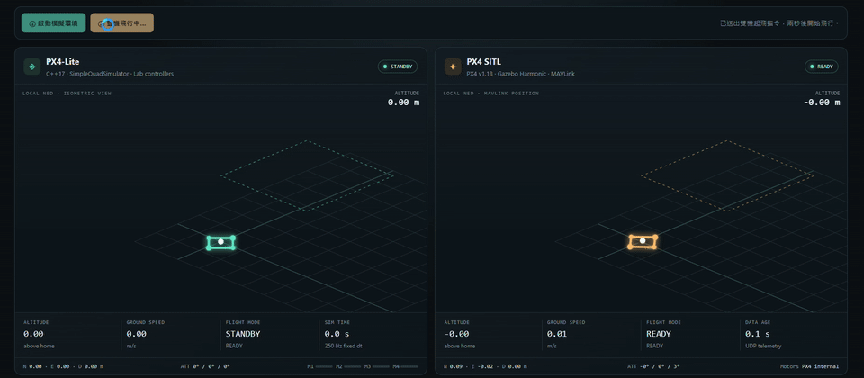

# PX4-Lite 仿作自研學習專案 (PX4-Lite Learning Monorepo)

## PX4-Lite / PX4 SITL 模擬展示

同一個網頁並排呈現 PX4-Lite 與 PX4 SITL 的飛行狀態、航線與即時遙測。下方為兩倍速預覽，點擊可開啟完整原速影片。

[](docs/media/px4-lite-comparison.mp4)

[觀看完整影片（MP4，約 0.60 MB）](docs/media/px4-lite-comparison.mp4) · [模擬器啟動與操作說明](simulator/README.md) · [展示素材與壓縮說明](docs/media/README.md)

---

本專案遵循真實 **PX4 Autopilot** 的架構思維與現代 C++17 規範，將大型無人機飛控系統拆解為 **8 大核心循序漸進實驗室（Lab 01 ～ Lab 08）**。
每個 Lab 均具備：
1. **完整規格說明文件 (`README.md`)**：闡明設計理念、PX4 核心模組對照、資料流與驗收標準。
2. **三階段循序漸進參考解答**：
   - **階段 1 (Stage 1 - 基礎版)**：掌握核心數學/資料結構演算法。
   - **階段 2 (Stage 2 - 核心進階版)**：加入工業級防護（Anti-Windup、型別安全、邊界檢查、多執行緒同步）。
   - **階段 3 (Stage 3 - PX4 對標進階版)**：全功能閉迴路整合、心跳超時自救、丟幀偵測、性能分析（Perf Counters）。
3. **使用者作業專區 (`user_homework/`)**：已修復語法錯誤並提供深度的架構點評與改良建議。

---

## 專案目錄結構 (Repository Structure)

```text
D:/px4-lite_learning/
├── CMakeLists.txt              # 全專案根建置檔 (一鍵編譯全體 Lab)
├── README.md                   # 專案總覽與建置執行手冊
├── 整體學習路線.md             # 原始學習路徑規劃文檔
├── lab01/                      # [原路徑相容] 使用者 Lab01 原始碼 (已修復可編譯)
└── labs/
    ├── 01_pubsub/              # Lab 01: uORB-lite 訊息發布訂閱中介軟體
    │   ├── README.md           # 詳細規格與驗收項目
    │   ├── user_homework/      # 使用者撰寫之作業 (含導師評語與改進剖析)
    │   ├── stage1_basic/       # 階段 1: Template 泛型化單緩衝 Pub/Sub
    │   ├── stage2_intermediate/# 階段 2: TopicBus 全域註冊與真實多執行緒 (250Hz)
    │   └── stage3_advanced/    # 階段 3: 原子世代鎖、遺失幀偵測 (Drop Count) 與百萬次壓測
    │
    ├── 02_workqueue/           # Lab 02: WorkQueue 協作式任務排程器
    │   ├── README.md           # 詳細規格與驗收項目
    │   ├── stage1_basic/       # 階段 1: 單一 Worker 執行緒與定時小頂堆
    │   ├── stage2_intermediate/# 階段 2: 雙優先級佇列 (HIGH 250Hz / LOW 10Hz)
    │   └── stage3_advanced/    # 階段 3: WorkItem 封裝、執行超時監控與阻塞連鎖效應實驗
    │
    ├── 03_clock_params/        # Lab 03: Clock 時間抽象與 Parameter 參數系統
    │   ├── README.md           # 詳細規格與驗收項目
    │   ├── stage1_basic/       # 階段 1: IClock 介面 (RealtimeClock vs SimulationClock)
    │   ├── stage2_intermediate/# 階段 2: 型別安全 ParameterManager (支援 Clamp 限制)
    │   └── stage3_advanced/    # 階段 3: parameter_update 廣播通知與控制迴路本地零開銷快取
    │
    ├── 04_quad_sim/            # Lab 04: 四旋翼物理動力學模擬器 (純 Plant 無 Controller)
    │   ├── README.md           # 詳細規格與驗收項目
    │   ├── stage1_basic/       # 階段 1: 1-DOF 垂直動力學 (升力 vs 重力)
    │   ├── stage2_intermediate/# 階段 2: 6-DOF 剛體動力學 (PX4 Quad-X 幾何扭矩與歐拉角積分)
    │   └── stage3_advanced/    # 階段 3: 馬達一階時間常數 (Motor Lag) 與合成 IMU 噪聲模型
    │
    ├── 05_rate_control/        # Lab 05: 角速度內環 PID 控制器與 Mixer 混控器
    │   ├── README.md           # 詳細規格與驗收項目
    │   ├── stage1_basic/       # 階段 1: 經典角速度 PID 控制數學公式
    │   ├── stage2_intermediate/# 階段 2: 抗積分飽和 (Anti-Windup)、D 項低通濾波與輸出飽和
    │   └── stage3_advanced/    # 階段 3: Quad-X 混控器與 6-DOF 閉迴路 +1.0 rad/s 階躍響應
    │
    ├── 06_attitude_control/    # Lab 06: 姿態估計器與串級姿態控制器
    │   ├── README.md           # 詳細規格與驗收項目
    │   ├── stage1_basic/       # 階段 1: 真值姿態外環 P 串級控制
    │   ├── stage2_intermediate/# 階段 2: 互補濾波器 (Complementary Filter 融合 Gyro+Accel)
    │   └── stage3_advanced/    # 階段 3: 完整閉迴路自穩驗證 (+15° 大傾角自動拉平至 < 0.8°)
    │
    ├── 07_commander/           # Lab 07: Commander 飛行狀態機與安全保護系統
    │   ├── README.md           # 詳細規格與驗收項目
    │   ├── stage1_basic/       # 階段 1: 有限狀態機 FSM (INIT, STANDBY, ARMED, FLYING, LANDING)
    │   ├── stage2_intermediate/# 階段 2: 預解鎖健康檢查 (Pre-arm Checks & Arm Denied)
    │   └── stage3_advanced/    # 階段 3: 飛行中心跳超時自動觸發 FAILSAFE 與完整 8 項單元測試
    │
    └── 08_runtime_tools/       # Lab 08: CLI 命令列、飛行日誌 Logger 與性能計數器 Perf
        ├── README.md           # 詳細規格與驗收項目
        ├── stage1_basic/       # 階段 1: CLI 命令直譯器 (topic list, topic hz, param show/set)
        ├── stage2_intermediate/# 階段 2: 飛行黑盒子 flight.csv 高頻記錄器 + plot_log.py 繪圖工具
        └── stage3_advanced/    # 階段 3: WorkQueue 性能計數器 (Perf Counter: avg/max/hz) 儀表板
│
└── supplementary/              # [進階架構補充庫]: 深入 PX4 原始碼五大核心架構
    ├── README.md               # 補充模組架構導讀與理論公式手冊
    ├── 01_ekf2_estimator/      # 模組 1: EKF2 擴展卡爾曼濾波與新息門限檢驗 (Innovation Gating)
    ├── 02_position_control/    # 模組 2: 3D 位置與速度控制器 (幾何姿態推力投影解算)
    ├── 03_sensor_voting_failover/# 模組 3: 多 IMU 投票仲裁與無縫故障切換 (Voting & Failover)
    ├── 04_control_allocator/   # 模組 4: 動態控制分配器與優先級消飽和策略 (Desaturation)
    └── 05_mavlink_bridge/      # 模組 5: MAVLink 2.0 微通訊引擎與 QGroundControl 握手
```

---

## 一鍵建置與執行指南 (Build & Run)

本專案支援標準 CMake 工具鏈（適用於 GCC / Clang / MSVC）：

### 1. 配置與編譯全專案
```bash
# 生成建置目錄
cmake -B build -G "Ninja"

# 編譯所有 Lab 與進階補充模組執行檔
cmake --build build
```

### 2. 執行各 Lab 執行檔範例

#### Lab 01 - Pub/Sub
- 使用者作業：`./build/labs/01_pubsub/lab01_user.exe`
- 階段 1 基礎版：`./build/labs/01_pubsub/lab01_stage1.exe`
- 階段 2 核心版：`./build/labs/01_pubsub/lab01_stage2.exe`
- 階段 3 進階版：`./build/labs/01_pubsub/lab01_stage3.exe`

#### Lab 02 - WorkQueue 排程器
- `./build/labs/02_workqueue/lab02_stage2.exe` (觀察 2 條執行緒調度 4 個任務)
- `./build/labs/02_workqueue/lab02_stage3.exe` (觀察 Blocking 任務造成的連鎖飢餓與 Overrun 告警)

#### Lab 04 - 四旋翼動力學
- `./build/labs/04_quad_sim/lab04_stage2.exe` (力矩與運動方向物理驗證)

#### Lab 05 - 角速度閉迴路控制
- `./build/labs/05_rate_control/lab05_stage3.exe` (階躍角速度自穩測試)

#### Lab 06 - 姿態串級自穩 (+15° 歸平)
- `./build/labs/06_attitude_control/lab06_stage3.exe` (互補濾波 + 串級閉迴路自穩)

#### Lab 07 - 飛行狀態機與 Failsafe
- `./build/labs/07_commander/lab07_stage3.exe` (8 項單元測試全綠通過)

#### Lab 08 - 診斷工具與日誌
- `./build/labs/08_runtime_tools/lab08_stage3.exe` (輸出 PX4 NSH 風格之性能健康儀表板)

---

### 3. 執行進階架構補充模組 (Supplementary Modules)

- **EKF2 狀態估計與突波剔除**：
  `./build/supplementary/supp01_ekf2.exe`
- **3D 位置控制空間懸停**：
  `./build/supplementary/supp02_pos_ctrl.exe`
- **多 IMU 投票仲裁與無縫熱備份容錯**：
  `./build/supplementary/supp03_voting.exe`
- **控制分配器與姿態優先消飽和**：
  `./build/supplementary/supp04_allocator.exe`
- **MAVLink 2.0 地面站雙向通訊**：
  `./build/supplementary/supp05_mavlink.exe`

